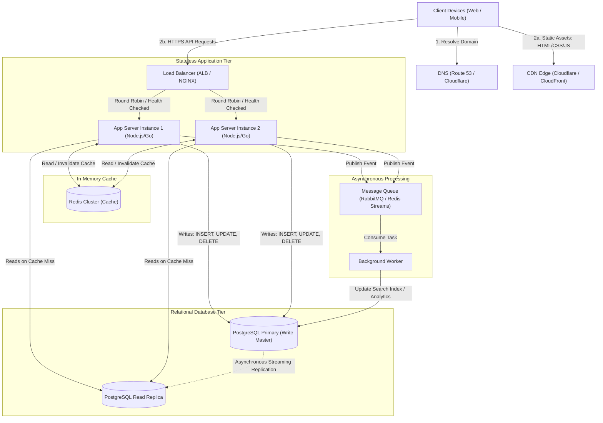

# QuickNotes System Architecture Specification

**Service Name:** QuickNotes Online Platform  
**Target Scale:** 1,000,000 Registered Users  
**Version:** 1.0.0  
**Status:** Approved for Backend Implementation  

---

## 1. Requirements

### 1.1 Functional Requirements
1. **Note Management (CRUD):** Users can create, read, update, delete, and list their personal notes.
2. **Tagging & Categorization:** Users can tag notes with one or more keywords and filter their notes by tag.
3. **Keyword Search:** Users can search notes by title and body text.
4. **User Isolation & Security:** All notes are strictly private; users can only access and modify their own notes through verified JWT authentication.
5. **Real-Time Client Feedback:** The API returns standard HTTP status codes and detailed validation error payloads.

### 1.2 Non-Functional Requirements
1. **High Availability:** 99.9% uptime (~8.76 hours maximum allowable downtime per year).
2. **Low Latency:**
   - Read operations (`GET /notes`): $p95 < 50\text{ ms}$, $p99 < 100\text{ ms}$.
   - Write operations (`POST /notes`): $p95 < 150\text{ ms}$.
3. **Scalability:** Horizontal scaling capable of handling traffic growth from 100,000 to 1,000,000+ registered users without architectural redesign.
4. **Data Durability & Consistency:** Strong ACID guarantees for writes; zero loss of user notes; recovery point objective (RPO) $< 1\text{ minute}$.
5. **Security & Compliance:** HTTPS/TLS 1.3 in transit, AES-256 encryption at rest, secure password hashing (Argon2id/bcrypt), and OWASP Top 10 mitigation.

---

## 2. Load Estimates & Sizing (1 Million Users)

### 2.1 User Activity Assumptions
- **Total Registered Users:** $1,000,000$
- **Daily Active Users (DAU):** $20\%$ of registered base $= 200,000\text{ DAU}$
- **Average Reads per Active User per Day:** $15\text{ reads/day}$ (opening app, refreshing feed, tag filtering)
- **Average Writes per Active User per Day:** $3\text{ writes/day}$ (creating new notes, editing, deleting)
- **Read-to-Write Ratio:** $5:1$ (read-heavy workload)
- **Peak Traffic Multiplier:** $2.5\times$ average load (to account for midday rush hours)

### 2.2 Throughput Calculations

#### Reads per Second (RPS)
$$\text{Total Reads/Day} = 200,000\text{ DAU} \times 15\text{ reads} = 3,000,000\text{ reads/day}$$
$$\text{Average Read RPS} = \frac{3,000,000\text{ reads}}{86,400\text{ seconds}} \approx 34.7\text{ reads/sec}$$
$$\text{Peak Read RPS} = 34.7 \times 2.5 \approx \mathbf{87\text{ reads/sec}}$$

*(Note: If calculated against the entire 1,000,000 user base as active concurrently, average read throughput is $\sim 174\text{ RPS}$, with peak at $\sim 435\text{ RPS}$. The system is sized for this upper bound).*

#### Writes per Second (WPS)
$$\text{Total Writes/Day} = 200,000\text{ DAU} \times 3\text{ writes} = 600,000\text{ writes/day}$$
$$\text{Average Write WPS} = \frac{600,000\text{ writes}}{86,400\text{ seconds}} \approx 6.94\text{ writes/sec}$$
$$\text{Peak Write WPS} = 6.94 \times 2.5 \approx \mathbf{17.4\text{ writes/sec}}$$

*(Upper bound at 1,000,000 active users: $\sim 35\text{ average WPS}$, $\sim 87.5\text{ peak WPS}$).*

### 2.3 Storage Estimates per Year

#### Data Size per Note Record
| Component | Average Size |
| :--- | :--- |
| Note ID (`BIGINT`) | 8 bytes |
| User ID (`BIGINT`) | 8 bytes |
| Title (`VARCHAR(100)`) | ~40 bytes |
| Body (`TEXT`) | ~500 bytes |
| Timestamps & Flags | 20 bytes |
| Tags Association Overhead (`note_tags`) | ~40 bytes |
| DB Row & B-Tree Index Overhead | ~384 bytes |
| **Total Effective Size per Note** | **$\approx 1\text{ KB}$** |

#### Annual Storage Accumulation
$$\text{New Notes per Day} = 200,000\text{ DAU} \times 2\text{ new notes} = 400,000\text{ notes/day}$$
$$\text{New Notes per Year} = 400,000 \times 365 = 146,000,000\text{ notes/year}$$
$$\text{Raw Note Storage per Year} = 146,000,000 \times 1\text{ KB} \approx 146\text{ GB/year}$$

Adding database indexing ($+30\%$), user accounts and metadata ($+10\text{ GB}$), and replication factor ($2\times$ read replica + automated snapshot storage):
$$\text{Total Production Database Storage Required (Year 1)} \approx \mathbf{250\text{ GB} - 350\text{ GB}}$$

This storage volume is easily accommodated by standard cloud block storage (e.g. AWS EBS gp3 volume), proving that a single scaled PostgreSQL cluster handles the annual footprint comfortably.

---

## 3. High-Level Architecture Diagram

```
                              +--------------------+
                              |    Clients (Web,   |
                              |   Mobile, Desktop) |
                              +--------------------+
                                        |
                                        v
                              +--------------------+
                              |  DNS (Route 53 /   |
                              |    Cloudflare)     |
                              +--------------------+
                                   |          |
                      Static Assets|          | API Requests
                                   v          v
                       +--------------+   +--------------------+
                       |  CDN (Edge   |   |   Load Balancer    |
                       |  Cloudflare/ |   |  (AWS ALB / NGINX) |
                       |  CloudFront) |   +--------------------+
                       +--------------+             |
                                                    | (Round Robin / Least Conn)
                                    +---------------+---------------+
                                    |                               |
                                    v                               v
                       +------------------------+      +------------------------+
                       |   App Server Node 1    |      |   App Server Node 2    |
                       |  (Stateless API Svc)   |      |  (Stateless API Svc)   |
                       +------------------------+      +------------------------+
                                    |       |                      |       |
                 +------------------+       |                      |       +------------------+
                 |                          +-----------+----------+                          |
                 v                                      v                                     v
       +--------------------+                 +--------------------+                +--------------------+
       |    Cache Tier      |                 |  Message Queue     |                | Database Tier      |
       |  (Redis Cluster)   |                 | (RabbitMQ / Redis) |                | (PostgreSQL)       |
       +--------------------+                 +--------------------+                +--------------------+
       | Fast note reads    |                           |                           | Primary (Writes)   |
       | User session cache |                           v                           |       | (Streaming |
       +--------------------+                 +--------------------+                |       v Replication)
                                              | Background Worker  |                | Read Replica       |
                                              | (Index / Digest)   |                | (Offload Reads)    |
                                              +--------------------+                +--------------------+
```

### Mermaid Architecture Diagram


---

## 4. Component Explanations (One Sentence per Component)

1. **Client (Web / Mobile App):** Renders the user interface, validates user input locally, and issues HTTPS requests to load, create, or delete notes.
2. **DNS (Cloudflare / AWS Route 53):** Translates the domain name `api.quicknotes.io` into edge IP addresses with low-latency GeoDNS routing.
3. **CDN (Content Delivery Network):** Caches and delivers static website assets (`index.html`, `style.css`, `api.js`) from global edge locations close to users to eliminate origin server load.
4. **Load Balancer (AWS ALB / NGINX):** Distributes incoming API traffic evenly across multiple application server instances and removes unhealthy instances automatically.
5. **App Servers (Stateless Instances 1 & 2+):** Executes application business logic, validates JWT authentication tokens, enforces authorization rules, and coordinates database operations.
6. **Cache (Redis Cluster):** Stores frequently read user notes in memory with expiration timers to serve read requests with sub-5ms latencies and shield the database.
7. **Primary Database (PostgreSQL Primary):** Persists all write operations (`INSERT`, `UPDATE`, `DELETE`) with strict ACID guarantees and streams changes to read replicas.
8. **Read Replica (PostgreSQL Replica):** Handles read queries (`SELECT`) asynchronously replicated from the primary to scale read capacity horizontally.
9. **Message Queue (RabbitMQ / Redis Streams):** Buffers non-critical and compute-intensive background jobs so user requests receive instant responses without waiting.
10. **Background Worker:** Consumes messages from the queue asynchronously to perform tasks such as full-text search indexing, tag analytics, and notification delivery.

---

## 5. Step-by-Step Request Flows

### 5.1 Flow of `GET /notes` (Read Request)

1. **Client Request:** The user navigates to QuickNotes or clicks "Load Notes". The client browser transmits an HTTPS request: `GET /api/v1/notes` containing the JWT bearer token in the `Authorization` header.
2. **Edge & Load Balancing:** DNS resolves to the Load Balancer IP. The Load Balancer terminates TLS/SSL and forwards the request to an available App Server instance based on least connections.
3. **Authentication:** The App Server validates the JWT signature and extracts the authenticated user's ID (`user_id = 104`).
4. **Cache Lookup:** The App Server checks Redis for the key `cache:notes:user:104`.
   - **Cache Hit:** If found, the App Server deserializes the cached JSON array and immediately returns `200 OK` to the Load Balancer and Client. (Total elapsed latency: $<10\text{ ms}$).
   - **Cache Miss:** If the key is not in Redis, the App Server proceeds to step 5.
5. **Database Query:** The App Server executes a query against the **PostgreSQL Read Replica**:
   ```sql
   SELECT id, title, body, created_at, updated_at
   FROM notes
   WHERE user_id = 104
   ORDER BY created_at DESC
   LIMIT 50;
   ```
6. **Populating Cache:** The App Server formats the records into JSON, writes the payload into Redis with a 300-second Time-To-Live (TTL), and responds with `200 OK`.
7. **Client Rendering:** The browser client receives the payload and renders the notes cleanly into the DOM using `textContent`.

---

### 5.2 Flow of `POST /notes` (Write Request)

1. **Client Submission:** The user fills in the note title, body, and tags, then submits the form. The client validates that title is non-empty and $\le 100$ characters, disables the submit button, and sends: `POST /api/v1/notes` with body `{ title, body, tags }` and the JWT header.
2. **Routing:** The Load Balancer inspects instance health and routes the request to an App Server.
3. **Authentication & Server-Side Validation:** The App Server verifies the JWT, checks that `title` is between 1 and 100 characters, sanitizes input, and rejects invalid requests with `400 Bad Request`.
4. **Database Transaction (Primary):** The App Server initiates a transaction on the **PostgreSQL Primary Database**:
   - Inserts the new note record into `notes` with `user_id = 104`.
   - For each tag in the request, resolves or creates the tag in `tags`, and inserts records into `note_tags`.
   - Commits the transaction and receives the generated `id` (e.g. `4822`).
5. **Cache Invalidation:** The App Server explicitly purges the user's cached notes from Redis (`DEL cache:notes:user:104`) to prevent stale reads on subsequent queries.
6. **Asynchronous Task Enqueueing:** The App Server publishes a lightweight event message to the **Message Queue**:
   ```json
   { "event": "note.created", "noteId": 4822, "userId": 104, "timestamp": "2026-10-18T22:30:00Z" }
   ```
7. **Synchronous Response:** The App Server immediately returns `201 Created` with the newly created note JSON payload to the client. The client adds the note to the top of the UI list and reenables the submit button.
8. **Asynchronous Worker Execution:** In the background, the **Background Worker** picks up the queue message, generates search engine index tokens, and records audit metrics without slowing down the client.

---

## 6. Architectural Trade-offs & Single Point of Failure (SPOF) Analysis

### 6.1 Architectural Trade-offs

#### Trade-off 1: Cache-Aside with Write-Invalidation vs. Write-Through Caching
- **Decision:** QuickNotes implements **Cache-Aside (Lazy Loading) with Write Invalidation**.
- **Alternative:** Write-Through Caching (writing simultaneously to cache and database on every insert/update).
- **Rationale:** Write-through caching incurs high memory overhead by caching every note written, even if the user never views it again. Cache-aside ensures that only actively read notes reside in expensive RAM. Furthermore, in write-through setups, cache and database dual-writes risk race conditions and inconsistent states if one destination fails. Invalidate-on-write guarantees that the next read will fetch freshly committed truth directly from the database replica.

#### Trade-off 2: Primary-Replica Asynchronous Replication vs. Synchronous Multi-Master
- **Decision:** Asynchronous streaming replication from one Primary DB to one or more Read Replicas.
- **Alternative:** Synchronous multi-region multi-master database cluster (e.g. CockroachDB or Spanner).
- **Rationale:** Synchronous replication requires consensus across multiple nodes for every single write, which adds 50–100ms network round-trip overhead per note creation. For a personal note-taking application, a brief replication lag of $<100\text{ ms}$ on reads is completely acceptable. By directing writes to a single primary and reads to replicas, we achieve high write speed, minimal operational complexity, and low infrastructure cost.

#### Trade-off 3: Relational SQL (PostgreSQL) vs. Document NoSQL (MongoDB)
- **Decision:** Relational PostgreSQL with normalized tables and foreign keys.
- **Alternative:** Document database storing embedded note documents.
- **Rationale:** While document stores allow flexible schemas, QuickNotes features strict relational requirements: notes belong to users, and notes share tags via a many-to-many relationship. Normalizing tags in SQL prevents data duplication and allows instantaneous cross-user tag renaming or usage analytics ($O(1)$ updates) without having to rewrite millions of nested JSON documents.

---

### 6.2 Single Point of Failure (SPOF) Avoidance Strategy

| Architecture Layer | Potential Single Point of Failure | Redundancy & Mitigation Strategy |
| :--- | :--- | :--- |
| **DNS Layer** | DNS provider outage | Managed Anycast DNS provider (Cloudflare / AWS Route 53) with automated health checks and secondary nameservers across disparate networks. |
| **Ingress / Load Balancer** | Load balancer instance failure | Managed AWS Application Load Balancer deployed across multiple Availability Zones (AZs); if one AZ experiences an outage, traffic automatically routes to surviving AZ nodes. |
| **Application Layer** | App server crash, memory leak, or OOM | Minimum of two stateless app server instances spread across distinct AZs; auto-scaling group automatically restarts failed instances and scales up during traffic spikes. |
| **Cache Tier** | Redis node failure | Redis Cluster with primary and replica nodes with Redis Sentinel automatic failover; if the entire cache tier becomes unavailable, app servers fall back gracefully to the read replica database without taking the app down. |
| **Database Tier (Primary)** | Primary database hardware or disk failure | Managed PostgreSQL with Multi-AZ automatic failover (hot standby replica); heartbeat monitors detect primary failure and promote the standby replica to primary in under 60 seconds. |
| **Database Tier (Replica)** | Read replica crash | Multiple read replicas configured behind a database connection pooler (PgBouncer); if one replica fails, queries automatically fall back to the surviving replica or temporary primary reads. |
| **Message Queue** | Queue broker crash | Clustered RabbitMQ broker nodes with persistent message disk buffering; messages are acknowledged only after successful worker execution to prevent data loss. |
